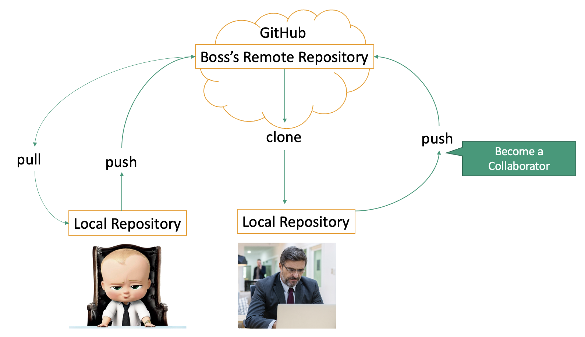
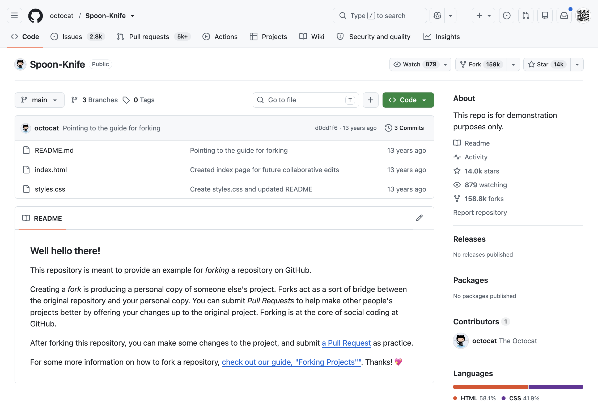
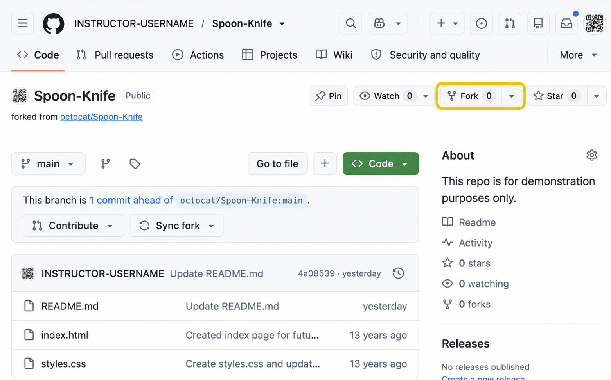
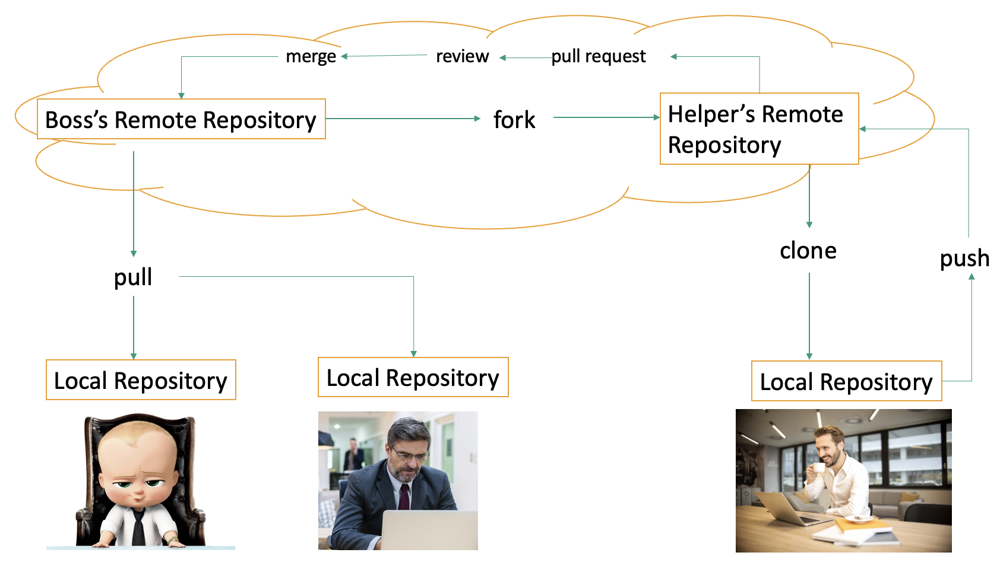
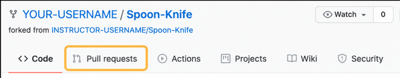
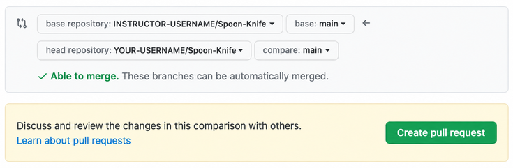
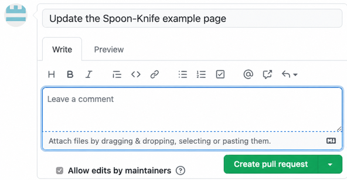
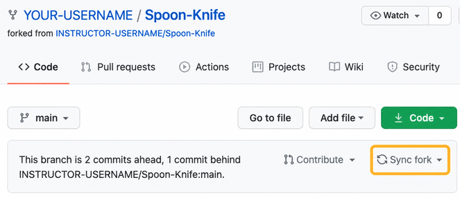
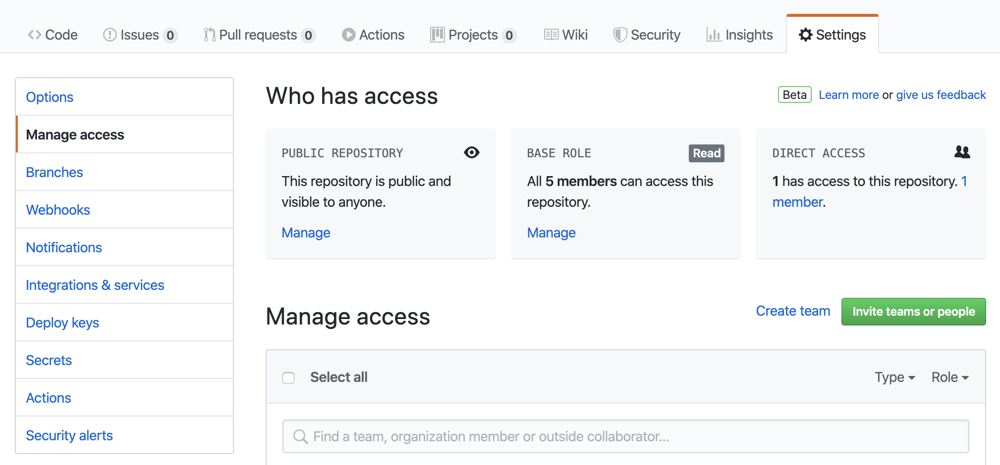

  

    Table of contents
  

  {: .text-delta }
 - TOC
{:toc}

# Collaborating on GitHub
{: .no_toc}

The GitHub platform facilitates collaboration by managing access and tracking activity on multi-author projects. A common workflow for teamwork is to use the _fork_, _clone_, and _pull request_ features of Git and GitHub. Consider this example:

> _A team of 10 people is writing a textbook. Everyone will contribute content and the files will be stored in the main branch of the project repository. To avoid unintended conflicts each team member will work in their own copy of the repository, periodically merging their work back into the main project repository._

 

Throughout this section of the workshop, you will practice this team workflow with GitHub's public [`octocat/Spoon-Knife`](https://github.com/octocat/Spoon-Knife) demonstration repository.

Here are some of the Git commands and GitHub features you will encounter in this workflow.

- **Fork**. A GitHub feature that makes a copy of another GitHub user's repository in your own GitHub account. You have full control over the fork because it's in your account. 
- **Clone**. A Git command that makes a local copy of a GitHub repository on your own computer. It allows you to write and edit using your preferred software, then commit and push your changes back to the repository on GitHub. (You can only push the changes back to GitHub if you have permission to edit the repository on GitHub.) 
- **Pull request**. A GitHub feature that allows the owner of the main project repository to "pull" in changes made in forks of the repository. When it's time to merge your own work with the main project repository, submit a "pull request" from your fork.

### Creating a fork
In this scenario, team members never edit the main project repository directly. Instead, each person works in a _fork_, a copy of the main repository in their own GitHub account.

GitHub provides [`octocat/Spoon-Knife`](https://github.com/octocat/Spoon-Knife) specifically for practicing how to fork and contribute to a repository. Your instructor will first demonstrate how to fork this repository, creating a workshop repository at `https://github.com/INSTRUCTOR-USERNAME/Spoon-Knife`.

After the instructor's fork has been created, open it using the address provided by your instructor and click _Fork_ in the top-right corner. On the next page, keep the repository name `Spoon-Knife` and click _Create fork_.

After GitHub creates the fork, its address will be `https://github.com/YOUR-USERNAME/Spoon-Knife`, with your GitHub username in place of `YOUR-USERNAME`.

## Clone your fork to your computer
The next step is to _clone_ your fork, creating a local copy that you can edit with your preferred text editor. *GitHub is great for storing and sharing files but it's not a good platform for editing.* 

*1*{: .circle .circle-blue} Open your fork of Spoon-Knife on GitHub, click _Code_, select _SSH_, and copy its SSH URL.

*2*{: .circle .circle-blue} Open a terminal and navigate to the directory where you want to store the local copy.

*3*{: .circle .circle-blue} Run the following command, replacing `YOUR-USERNAME` with your GitHub username.

Input
{: .label .label-green}
~~~
$ git clone git@github.com:YOUR-USERNAME/Spoon-Knife.git
~~~
{: .shell-input}

Output
{: .label .label-yellow}
~~~
Cloning into 'Spoon-Knife'...
remote: Counting objects: 10, done.
remote: Compressing objects: 100% (8/8), done.
remote: Total 10 (delta 1), reused 10 (delta 1)
Receiving objects: 100% (10/10), done.
~~~
Git creates a directory named `Spoon-Knife`, after the source repository.  The directory is automatically tracked by git and it can be synchronized with its counterpart in your GitHub account. 

 

## Synchronizing forks and clones
As team members edit files in their local Spoon-Knife clones, they use `git add` and `git commit` to take snapshots of their work. In a team environment, it is important to periodically synchronize the forks and clones so everyone's work is represented in the main project repository.

### Pushing local changes to your fork
It is good practice to regularly synchronize your local copy of the repository (the _clone_) with the repository in your own GitHub account (the _fork_).

To do this, open a terminal in your clone directory and run the command `git push`

Only local changes that have been _committed_ will be pushed back up to the fork on GitHub.
{: .note}

### Contributing to the main project repository
Once your work is in your _fork_ on GitHub, you can contribute it to the instructor's `INSTRUCTOR-USERNAME/Spoon-Knife` repository by using a _pull request_. This alerts the instructor and invites them to "pull" your contribution into the main project repository, merging it with changes from other team members.

*1*{: .circle .circle-blue} To create a _pull request_, navigate to your Spoon-Knife fork on GitHub and click the _Pull requests_ link.

*2*{: .circle .circle-blue} Click _New pull request_, then click _Create pull request_.

*3*{: .circle .circle-blue} You will be prompted to provide a title and optional comment that helps the team understand your contribution to the main project repository.

*4*{: .circle .circle-blue} Click _Create pull request_ to submit your contribution. The instructor then has the opportunity to review your changes before merging them with the work of other team members. Before creating the pull request, confirm that the base repository is `INSTRUCTOR-USERNAME/Spoon-Knife`.

### Keeping your fork current
A _fork_ is a copy of a repository at a moment in time. As other team members contribute to the instructor's Spoon-Knife fork, your own Spoon-Knife fork may no longer reflect the current state of the main project. When your fork is behind, open it on GitHub, click _Sync fork_, and then click _Update branch_ to incorporate the latest changes from the team.

### Keeping your local copy current
_Sync fork_ will update the Spoon-Knife fork in your GitHub account. To bring those same changes down to the _clone_ on your local machine, use the `git pull` command.

*1*{: .circle .circle-blue} Open a terminal and navigate to the cloned `Spoon-Knife` repository in your local file system.

*2*{: .circle .circle-blue} Use `git pull origin main` to incorporate content from your Spoon-Knife fork on GitHub.

### A Basic Collaborative Workflow

When collaborating, it is important to work from an updated version of the repository, so you should `git pull` before making any changes. A basic workflow for collaboration might look like this:

* update your local repository with `git pull origin main`,
* make your changes and stage them with `git add`,
* commit your changes with `git commit -m`, and
* upload the changes to your Spoon-Knife fork with `git push origin main`.

Note: it is a good idea to make frequent commits to keep a history of changes in the Git repository and prevent conflicts with other collaborators on the project.

## Exercise

In this exercise, you are going to use Git and GitHub to make a small change to the instructor's Spoon-Knife fork. Your instructor will provide a repository address in the form `https://github.com/INSTRUCTOR-USERNAME/Spoon-Knife`. Open that repository, fork it to your GitHub account, and then clone your fork to your computer.

Open `index.html` in a text editor and make a small change, such as adding a sentence. Use `git add` and `git commit` to record your change, then push it to your Spoon-Knife fork. Finally, follow the steps above to prepare a pull request from your fork to the instructor's Spoon-Knife fork. Confirm that the base repository is `INSTRUCTOR-USERNAME/Spoon-Knife` before creating the pull request.

Spoon-Knife is a public practice repository, so any pull request you submit will be visible to everyone. Do not include personal or sensitive information.
{: .note}

## Another Exercise

For the next step, get into pairs. One person will be the "Owner" and the other will be the "Collaborator." The Owner will use the Spoon-Knife fork in their GitHub account. The goal is for the Collaborator to add changes to the Owner's Spoon-Knife fork. If there is time, switch roles at the end so everyone can play Owner and Collaborator.

First, the Owner needs to give the Collaborator access to their Spoon-Knife fork. Navigate to the fork on GitHub, click _Settings_, select _Collaborators_, and invite your partner using their GitHub username.

To accept access to the Owner's fork, the Collaborator needs to go to [https://github.com/notifications](https://github.com/notifications).

Next, the Collaborator needs to clone the Owner's Spoon-Knife fork onto their computer. To clone it to the `Desktop`, the Collaborator would enter this command, replacing `OWNER-USERNAME` with the Owner's GitHub username:

Input
{: .label .label-green}
~~~
$ git clone git@github.com:OWNER-USERNAME/Spoon-Knife.git ~/Desktop/owner-Spoon-Knife
~~~
{: .shell-input}

This creates a local copy of the Owner's Spoon-Knife fork in a folder named <em>owner-Spoon-Knife</em>. The Collaborator can now make changes using the commands introduced earlier.

- use `cd` to navigate to the cloned repository
- edit `index.html` using a text editor
- use `git add` to stage the file
- use `git commit -m "Commit note"` to commit the changes

Then push the Collaborator's changes to the _Owner's_ Spoon-Knife fork on GitHub:

Input
{: .label .label-green}
~~~
$ git push origin main
~~~
{: .shell-input}

This time, you did not have to create a remote called `origin`: Git uses this name by default when you clone a repository.

Take another look at the Owner's Spoon-Knife fork on GitHub. You may need to refresh the browser to see the new commit made by the Collaborator.

To download the Collaborator's changes from GitHub, the Owner now enters this command in their own local Spoon-Knife clone:

Input
{: .label .label-green}
~~~
$ git pull origin main
~~~
{: .shell-input}

Now the three repositories—the Owner's local clone, the Collaborator's local clone, and the Owner's Spoon-Knife fork on GitHub—are back in sync.

___Switch Owner and Collaborator roles if time permits and you would like more practice.___
